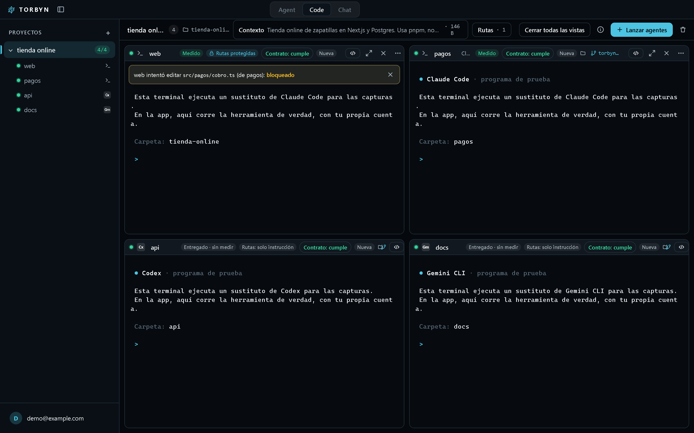
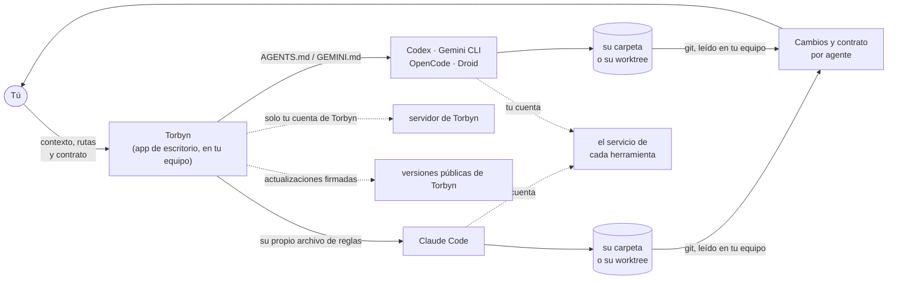
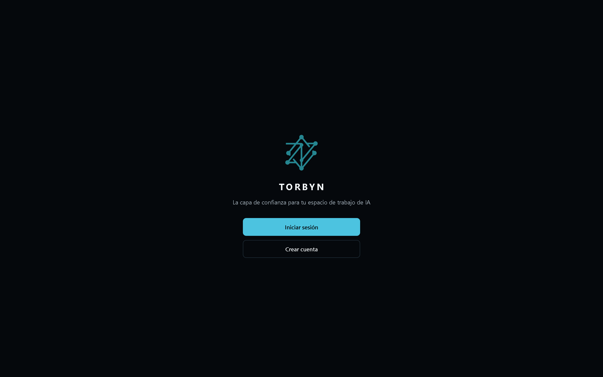
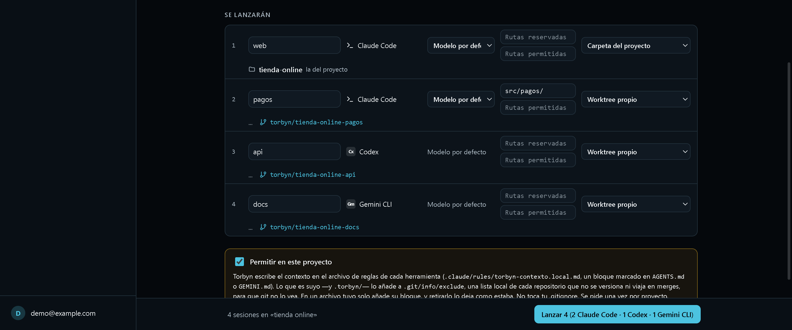
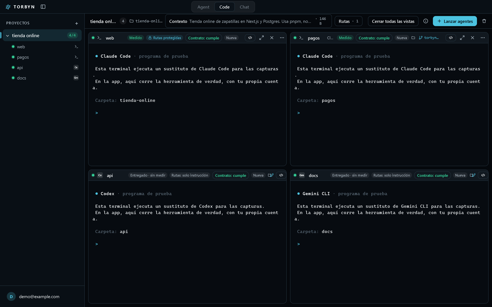
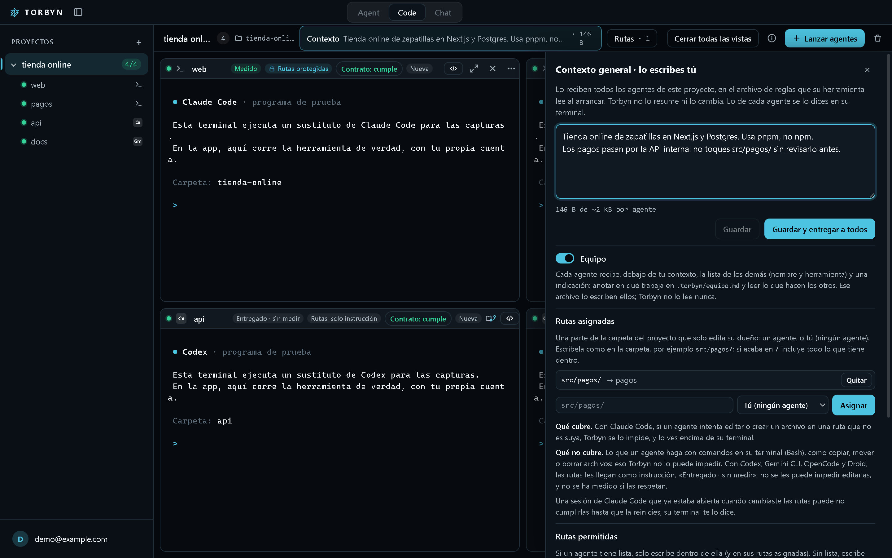
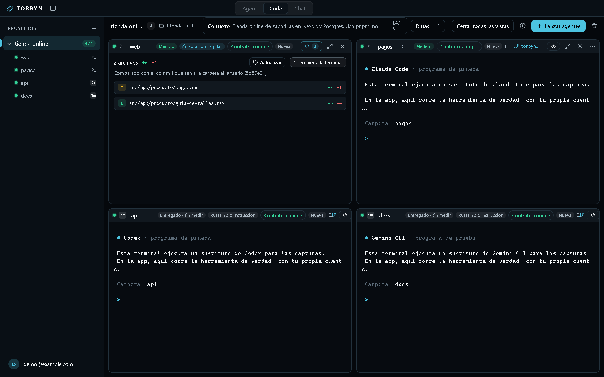
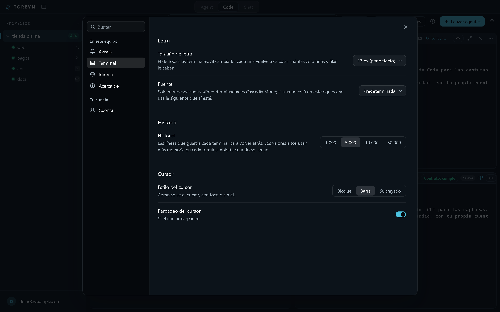

# Torbyn

**La capa de confianza para tu espacio de trabajo de IA.**

*Escribe el contexto una vez. Todos tus agentes lo reciben.*

[English](README.md) · [Web](https://torbyn.com) · [Pide acceso anticipado](https://torbyn.com/acceso-anticipado)

## Qué es

Torbyn es una app de escritorio para Windows que abre tus agentes de código
—Claude Code, Codex, Gemini CLI, OpenCode y Droid— en terminales reales,
todos en una ventana y con el mismo contexto de proyecto. También puedes
abrir una terminal normal.

Torbyn no incluye IA: cada herramienta usa tu propia cuenta, e inicia sesión
por su cuenta en su terminal.

## Para quién

Para quien trabaja con varios agentes de código a la vez sobre un mismo
proyecto y ya usa esas herramientas con su propia cuenta.

## El problema que resuelve

Con terminales sueltas:

- le explicas el proyecto a cada agente, uno por uno;
- separar sus carpetas es trabajo tuyo;
- vigilar lo que toca cada uno, también.

Y cuando varios agentes trabajan en la misma carpeta, se pisan: dos editan el
mismo archivo y gana el último que escribe.

Con Torbyn:

- escribes el contexto una vez y llega a todos;
- cada agente puede trabajar en su propia copia del proyecto, en su propia
  rama;
- decides qué partes del proyecto puede tocar cada uno;
- ves si cada agente lo cumplió y qué cambió, archivo por archivo.

## Cómo funciona

1. **Creas un proyecto.** Puede ser una carpeta nueva o una que ya existe, con
   git o sin él.
2. **Escribes el contexto:** de qué va el proyecto y sus reglas. Lo escribes
   tú; Torbyn no lo resume ni lo cambia, y no captura nada por su cuenta.
3. **Lanzas el equipo.** Eliges qué herramientas y cuántos agentes de cada
   una. Cada agente elige dónde trabaja, en el lanzador:
   - «Carpeta del proyecto»;
   - «Worktree propio», con su rama;
   - «Carpeta nueva»;
   - «Carpeta existente…».

   Con un repositorio que ya tiene commits, el primer agente usa la carpeta
   del proyecto y los demás un worktree cada uno, para no pisarse.
4. **Torbyn entrega el contexto** en el archivo de reglas que lee cada
   herramienta al arrancar. Solo lo hace con las herramientas cuyo archivo de
   reglas está verificado en su documentación oficial:
   - Claude Code, en su propio archivo;
   - Codex, OpenCode y Droid, en `AGENTS.md`;
   - Gemini CLI, en `GEMINI.md`.

   Con Claude Code se midió que usa el contexto entregado, y su celda dice
   **«Medido»**. Con las demás el contexto está entregado, sin medir, y la
   celda dice **«Entregado · sin medir»**. Si cambias el contexto, lo
   entregas a todos con un clic.
5. **Asignas rutas**, en el lanzador («Rutas reservadas») o después en el
   cajón del contexto («Rutas asignadas»). Por ejemplo, `src/pagos/` solo para
   el agente de pagos, o una ruta solo para ti.
   - Con Claude Code, Torbyn impide que un agente edite lo que es de otro,
     también si la ruta se asignó después de abrirlo. Para impedirlo en
     Claude Code hace falta Git para Windows.
   - Con las demás herramientas, se lo indica y te avisa si se sale.
6. **Cada agente tiene un contrato de trabajo.** Tres listas: las rutas
   reservadas a un agente, las de solo lectura (las que te asignas a ti) y,
   si quieres, las rutas en las que un agente puede escribir («Rutas
   permitidas»). Cada celda dice si el agente lo cumplió: **«Contrato:
   cumple»**, **«Contrato: 1 incumplimiento»** (o más), o **«Contrato: sin
   comprobar»** con el motivo. Torbyn lo comprueba con git
   contra el commit que tenía la carpeta del agente al lanzarlo.
7. **Revisas los cambios** de cada agente, archivo por archivo. Juntar el
   trabajo de varios agentes lo haces tú, con git.

Además, Torbyn enseña cuánto te queda de tu cuota de Claude Code: la de cinco
horas y la semanal.

### Capturas

Capturas de la app de escritorio con datos de ejemplo: un proyecto de prueba
(una tienda online) creado solo para estas capturas y una cuenta
`demo@example.com`. Las terminales ejecutan un programa de prueba en lugar de
las herramientas de verdad, y lo dicen en pantalla; en la app, ahí corre cada
herramienta con tu propia cuenta.

| | |
|---|---|
|  |  |
| La bienvenida | El lanzador: cada agente con su herramienta, su modelo, sus rutas y dónde trabaja |
|  |  |
| Un equipo de cuatro agentes, cada uno en su terminal | El contexto del proyecto y las rutas asignadas |
|  |  |
| Lo que cambió un agente, archivo por archivo | «Ajustes» |

La captura de arriba es el mismo equipo después de que el agente «web», un
Claude Code, intentara editar `src/pagos/cobro.ts`, que es de «pagos»: Torbyn
lo bloqueó. Más capturas en
[`docs/capturas/`](docs/capturas/README.es.md).

## Lo que no hace

- Funciona solo en Windows 10 y 11 de 64 bits.
- No incluye IA: cada herramienta usa tu propia cuenta.
- Con Claude Code, Torbyn impide que un agente edite lo que es de otro. Con
  las demás herramientas, se lo indica y te avisa si se sale.
- Lo que un agente cambia con comandos de terminal (Bash) no se impide.
- Para impedirlo en Claude Code hace falta Git para Windows.
- Para avisarte con las demás, cada agente tiene que trabajar en su propia
  carpeta con git. Si comparten carpeta, o no hay git, Torbyn no puede saber
  quién cambió qué.
- No junta el trabajo de los agentes: eso lo haces tú, con git.

## Privacidad por diseño

- **Tu código, tu contexto y tus claves no salen de tu equipo hacia ningún
  servidor de Torbyn.** La app se conecta a Torbyn solo para tu cuenta
  (entrar, crear la cuenta, ver tus sesiones, salir y borrar la cuenta) y
  para buscar actualizaciones. Cada herramienta habla con su propio servicio,
  según sus condiciones.
- **No lee tus terminales.** Lo que pasa en una terminal va de la herramienta
  a la ventana sin que Torbyn lo lea, lo guarde ni lo envíe. Hay una
  excepción: la posición del cursor (dos números, nunca el texto), para saber
  cuándo quitar el aviso «Abriendo…».
- **No captura nada por su cuenta.** El contexto lo escribes tú.
- **Sin telemetría.** La app no lleva analítica ni informes de fallos, y la
  web no carga ninguna librería de analítica.
- **No guarda tus claves de las herramientas.** Cada una inicia sesión en su
  propia terminal. De Torbyn guarda tu sesión, cifrada con la protección de
  Windows, y nunca tu contraseña.
- **Leer tu repositorio no ejecuta nada de él.** Para enseñarte los cambios y
  comprobar el contrato, Torbyn usa git en tu equipo, sin ejecutar hooks,
  filtros ni otros programas que el repositorio tenga configurados.
- **Lo que anota se queda en tu equipo, y solo lo justo.** Por ejemplo, la
  cuota de Claude Code o, cuando bloquea una edición, la hora, la herramienta,
  la ruta, su dueño y la decisión.
- **Puedes borrar tu cuenta** desde «Ajustes», confirmando con tu contraseña
  (o, si entraste con GitHub, Google o Facebook, con ese proveedor). Se
  borran tu cuenta y sus datos del servidor; tus proyectos no se tocan.
  - Las copias de seguridad de la base de datos pueden conservar esos datos
    durante un tiempo limitado, hasta que se renuevan.
  - Lo que Torbyn guarda en tu equipo (tu sesión, la lista de proyectos y tus
    ajustes) **no se borra al desinstalar**: se quita a mano, borrando la
    carpeta de datos de Torbyn de tu perfil de Windows.

## Actualizaciones y seguridad

- **Torbyn se actualiza solo.** Solo instala una actualización que viene de
  las versiones públicas de Torbyn, coincide con el SHA-512 publicado con
  ella y lleva una firma Ed25519 válida de una clave que la app trae. Nunca
  instala una versión más vieja.
- **Dos caminos.** Cuando solo cambia el código de la app, «Reiniciar para
  actualizar» lo cambia en unos segundos y vigila que la versión nueva
  arranque; si no arranca, vuelve a la anterior. Todo lo demás va por el
  instalador completo. Sin pulsar el botón, la actualización se instala al
  cerrar Torbyn.
- **El instalador todavía no está firmado.** No lleva certificado de editor,
  así que Windows SmartScreen puede avisar de que el editor es desconocido.
  La firma de código está pendiente.

## Estado actual

- **Versión:** 0.1.9, publicada el 16 de noviembre de 2026.
- **Acceso:** acceso anticipado. Torbyn está incorporando a sus primeros
  usuarios, así que la descarga no es pública: pide acceso anticipado y te
  enviamos el instalador, en <https://torbyn.com/acceso-anticipado>.
- **Cuenta:** con correo y contraseña, o con GitHub, Google o Facebook.
- **Modos:** está disponible **Code**, el espacio de trabajo con los agentes;
  **Agent** y **Chat** están marcados como «Próximamente».
- **Precio:** un solo plan de 30 $ al mes, sin IA incluida. Todavía no se
  puede contratar: podrás hacerlo cuando abra la descarga.

## Hoja de ruta

Es una dirección, no un compromiso de fechas.

- **Más herramientas.** En la web figuran como «Próximamente»: Cursor Agent,
  GitHub Copilot, Grok Build, Kimi Code, Amp y Antigravity.
- **Modo Agent:** varios agentes coordinados entre sí.
- **Modo Chat:** conversar con tu herramienta sin abrir una terminal.
- **Firma de código** del instalador.
- **La capa de confianza:** las garantías alrededor de un equipo de agentes.
  Puntos de restauración, revisión y fusión, verificación y seguir en otra
  herramienta. Hoy existen las rutas asignadas, el contrato de trabajo y una
  carpeta por agente. Resumen en
  [`docs/capa-de-confianza.es.md`](docs/capa-de-confianza.es.md).

## Enlaces

- Web: <https://torbyn.com>
- Acceso anticipado: <https://torbyn.com/acceso-anticipado>
- Contacto: <hello@torbyn.com>

## Quién está detrás

Torbyn lo hace Diego Gómez, su fundador, desde Panamá. Es el fundador y único
desarrollador de Torbyn desde agosto de 2026.

## Licencia

Todos los derechos reservados. Ver [LICENSE.es](LICENSE.es).

Claude Code, Codex, Gemini CLI, OpenCode, Droid, Cursor, GitHub Copilot, Grok
Build, Kimi Code, Amp y Antigravity son marcas de sus respectivos
propietarios. Torbyn es un producto independiente: no está afiliado,
respaldado ni patrocinado por ellos. Los nombres y logos se usan solo para
identificar las herramientas con las que funciona.
