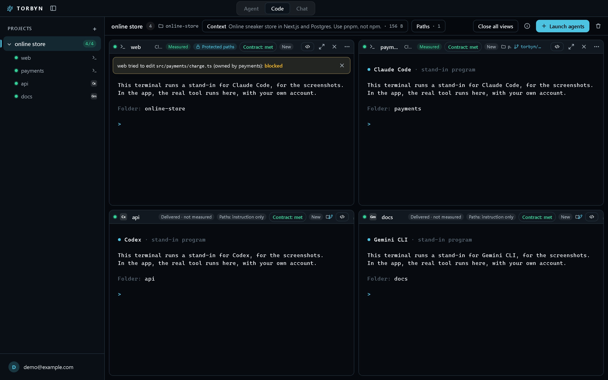
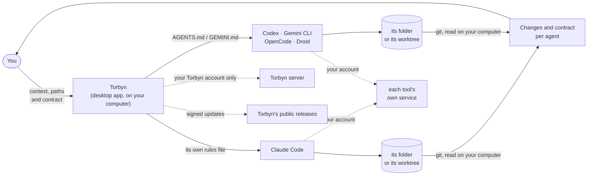
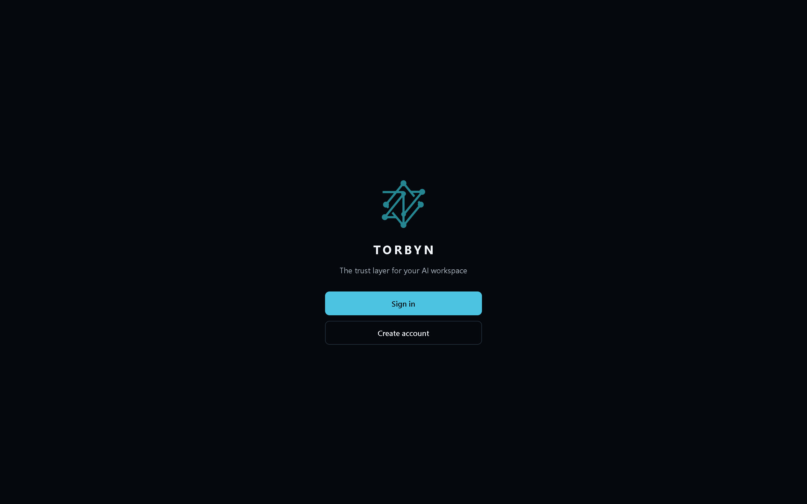
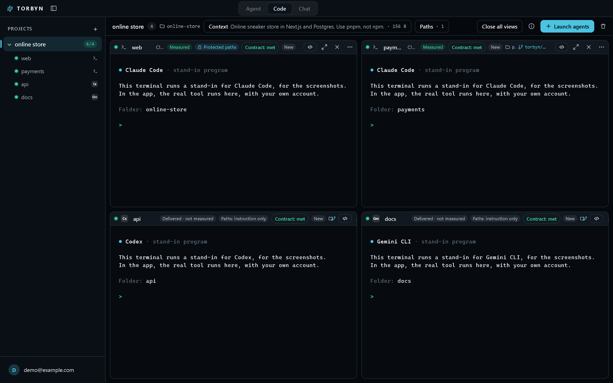
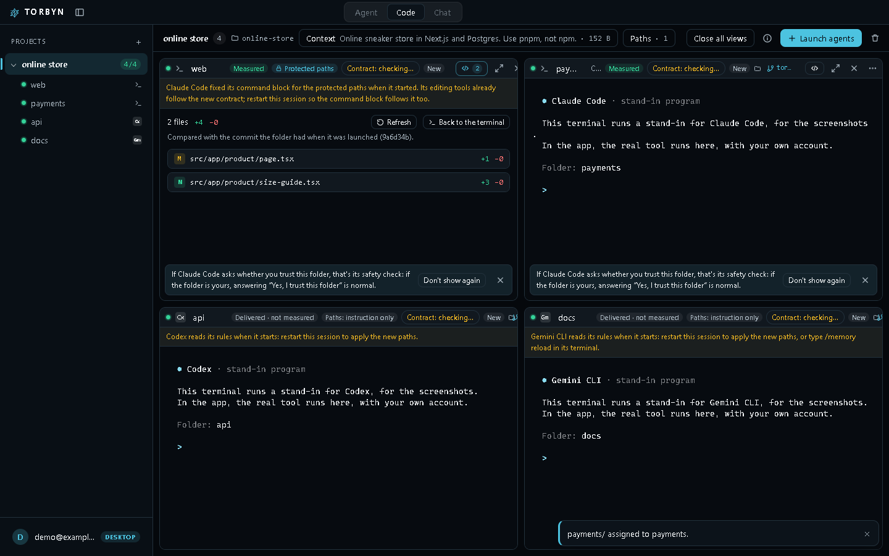
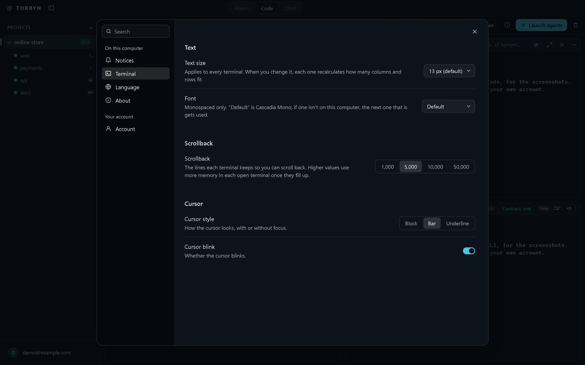

# Torbyn

**The trust layer for your AI workspace.**

*Write the context once. Every agent gets it.*

[Español](README.es.md) · [Website](https://torbyn.com/en) · [Request early access](https://torbyn.com/en/acceso-anticipado)

## What it is

Torbyn is a Windows desktop app that opens your coding agents —Claude Code,
Codex, Gemini CLI, OpenCode and Droid— in real terminals, all in one window
and with the same project context. You can also open a plain terminal.

Torbyn includes no AI: each tool uses your own account. Each one signs in on
its own, in its own terminal.

## Who it is for

People who work with several coding agents at once on the same project and
already use those tools with their own account.

## The problem it solves

With separate terminals:

- you explain the project to each agent, one by one;
- keeping their folders apart is up to you;
- so is watching what each one touches.

And when several agents work in the same folder, they overwrite each other:
two of them edit the same file and the last one to write wins.

With Torbyn:

- you write the context once and it reaches all of them;
- each agent can work in its own copy of the project, on its own branch;
- you decide which parts of the project each one can touch;
- you see whether each agent kept to that, and what it changed, file by file.

## How it works

1. **You create a project.** It can be a new folder or an existing one, with
   or without git.
2. **You write the context:** what the project is about and its rules. You
   write it; Torbyn doesn't summarise or change it, and it captures nothing
   on its own.
3. **You launch the team.** You pick which tools and how many agents of each.
   Each agent chooses where it works, in the launcher:
   - “Project folder”;
   - “Own worktree”, on its own branch;
   - “New folder”;
   - “Existing folder…”.

   With a repository that already has commits, the first agent uses the
   project folder and the rest get a worktree each, so they don't overwrite
   each other.
4. **Torbyn delivers the context** in the rules file each tool reads when it
   starts. It only does so with tools whose rules file is verified in their
   official documentation:
   - Claude Code, in its own file;
   - Codex, OpenCode and Droid, in `AGENTS.md`;
   - Gemini CLI, in `GEMINI.md`.

   With Claude Code it was measured that it uses the delivered context, and
   its cell says **“Measured”**. With the others the context is delivered but
   not measured, and the cell says **“Delivered · not measured”**. If you
   change the context, you deliver it to all of them with one click.
5. **You assign paths**, in the launcher (“Reserved paths”) or later in the
   context drawer (“Assigned paths”). For example, `src/payments/` only for
   the payments agent, or a path only for you.
   - With Claude Code, Torbyn stops an agent from editing what belongs to
     another, also if the path was assigned after it opened. Stopping it in
     Claude Code needs Git for Windows.
   - With the other tools, Torbyn tells them and warns you if they step out.
6. **Each agent has a work contract.** Three lists: the paths reserved for
   an agent, the read-only ones (assigned to you), and, if you want, the
   paths an agent is allowed to write in (“Allowed paths”). Each cell says
   whether the agent kept to it: **“Contract: met”**, **“Contract: 1
   breach”** (or more), or **“Contract: not checked”** with the reason. Torbyn checks it with git against the commit
   the agent's folder had when it was launched.
7. **You review the changes** of each agent, file by file. Putting several
   agents' work together is up to you, with git.

Torbyn also shows how much of your Claude Code quota you have left: the
five-hour one and the weekly one.

### Screenshots

Screenshots of the desktop app with sample data: a test project (an online
store) made only for these screenshots, and a `demo@example.com` account. The
terminals run a stand-in program instead of the real tools, and say so on
screen; in the app, each tool runs there with your own account.

| | |
|---|---|
|  |  |
| The welcome screen | The launcher: each agent with its tool, its model, its paths and where it works |
|  |  |
| A team of four agents, each in its own terminal | The project context and the assigned paths |
|  |  |
| What one agent changed, file by file | “Settings” |

The screenshot at the top shows the same team after the “web” agent, a
Claude Code, tried to edit `src/payments/charge.ts`, which belongs to
“payments”: Torbyn blocked it. More screenshots in
[`docs/capturas/`](docs/capturas/README.md).

## What it doesn't do

- It only runs on 64-bit Windows 10 and 11.
- It includes no AI: each tool uses your own account.
- With Claude Code, Torbyn stops an agent from editing what belongs to
  another. With the other tools, it tells them and warns you if they step
  out.
- What an agent changes with terminal commands (Bash) is not stopped.
- Stopping it in Claude Code needs Git for Windows.
- To warn you with the other tools, each agent has to work in its own folder
  with git. If they share a folder, or there is no git, Torbyn can't tell who
  changed what.
- It doesn't put the agents' work together: you do that, with git.

## Privacy by design

- **Your code, your context and your keys don't leave your computer for any
  Torbyn server.** The app connects to Torbyn only for your account (sign
  in, create the account, see your sessions, sign out and delete the
  account) and to check for updates. Each tool talks to its own service,
  under its own terms.
- **It doesn't read your terminals.** What happens in a terminal goes from
  the tool to the window without Torbyn reading, storing or sending it. There
  is one exception: the cursor position (two numbers, never the text), to
  know when to remove the “Opening…” notice.
- **It captures nothing on its own.** You write the context.
- **No telemetry.** The app carries no analytics or crash reporting, and the
  website loads no analytics library.
- **It doesn't store your tools' keys.** Each one signs in in its own
  terminal. For Torbyn it stores your session, encrypted with Windows'
  protection, and never your password.
- **Reading your repository runs nothing from it.** To show you the changes
  and check the contract, Torbyn uses git on your computer, without running
  hooks, filters or other programs the repository has configured.
- **What it records stays on your computer, and only what's needed.** For
  example, the Claude Code quota or, when it blocks an edit, the time, the
  tool, the path, its owner and the decision.
- **You can delete your account** from “Settings”, confirming with your
  password (or, if you signed in with GitHub, Google or Facebook, with that
  provider). Your account and its data are deleted from the server; your
  projects are left untouched.
  - Database backups may keep that data for a limited time, until they are
    rotated.
  - What Torbyn stores on your computer (your session, your project list and
    your settings) **is not deleted when you uninstall**: you remove it by
    hand, by deleting Torbyn's data folder from your Windows profile.

## Updates and security

- **Torbyn updates itself.** It only installs an update that comes from
  Torbyn's public releases, matches the SHA-512 published with it and carries
  a valid Ed25519 signature from a key the app ships with. It never installs
  an older version.
- **Two ways in.** When only the app's code changes, “Restart to update”
  swaps it in a few seconds and watches that the new version starts; if it
  doesn't, it goes back to the previous one. Anything else goes through the
  full installer. Without pressing the button, the update installs when you
  close Torbyn.
- **The installer isn't code-signed yet.** It has no publisher certificate,
  so Windows SmartScreen may warn that the publisher is unknown. Code signing
  is pending.

## Current status

- **Version:** 0.1.9, released on 16 November 2026.
- **Access:** early access. Torbyn is onboarding its first users, so the
  download isn't public: request early access and we'll send you the
  installer, at <https://torbyn.com/en/acceso-anticipado>.
- **Account:** with email and password, or with GitHub, Google or Facebook.
- **Modes:** **Code**, the workspace with the agents, is available; **Agent**
  and **Chat** are marked “Coming soon”.
- **Price:** a single plan at $30 a month, with no AI included. It can't be
  bought yet: you'll be able to when the download opens.

## Roadmap

A direction, not a commitment to dates.

- **More tools.** Listed on the website as “Coming soon”: Cursor Agent,
  GitHub Copilot, Grok Build, Kimi Code, Amp and Antigravity.
- **Agent mode:** several agents coordinated with each other.
- **Chat mode:** talk to your tool without opening a terminal.
- **Code signing** for the installer.
- **The trust layer:** guarantees around a team of agents. Restore points,
  review and merge, verification and continuing in another tool. Today,
  assigned paths, the work contract and a folder per agent exist. Summary in
  [`docs/capa-de-confianza.md`](docs/capa-de-confianza.md).

## Links

- Website: <https://torbyn.com/en>
- Early access: <https://torbyn.com/en/acceso-anticipado>
- Contact: <hello@torbyn.com>

## Who's behind it

Torbyn is made by Diego Gómez, its founder, from Panama. Founder and sole
developer of Torbyn since August 2026.

## License

All rights reserved. See [LICENSE](LICENSE).

Claude Code, Codex, Gemini CLI, OpenCode, Droid, Cursor, GitHub Copilot, Grok
Build, Kimi Code, Amp and Antigravity are trademarks of their respective
owners. Torbyn is an independent product: it is not affiliated with, endorsed
by, or sponsored by them. Names and logos are used only to identify the tools
it works with.
