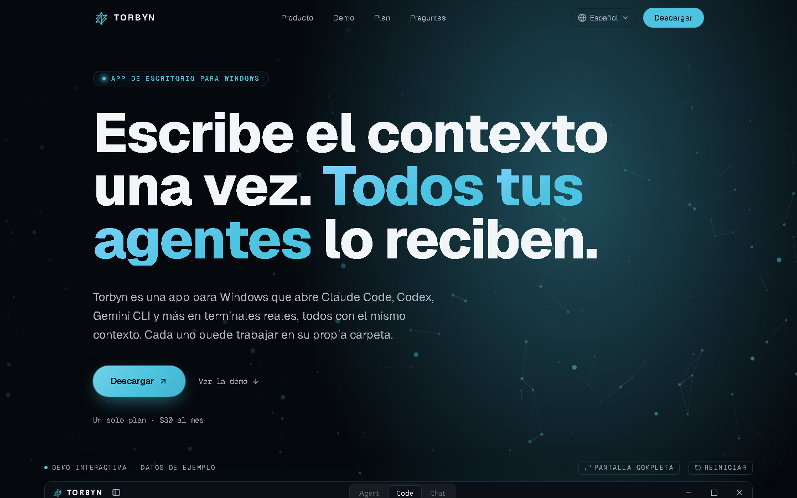
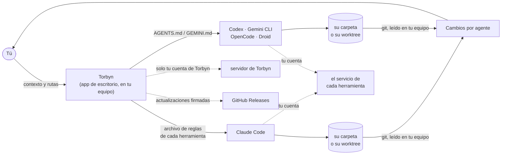
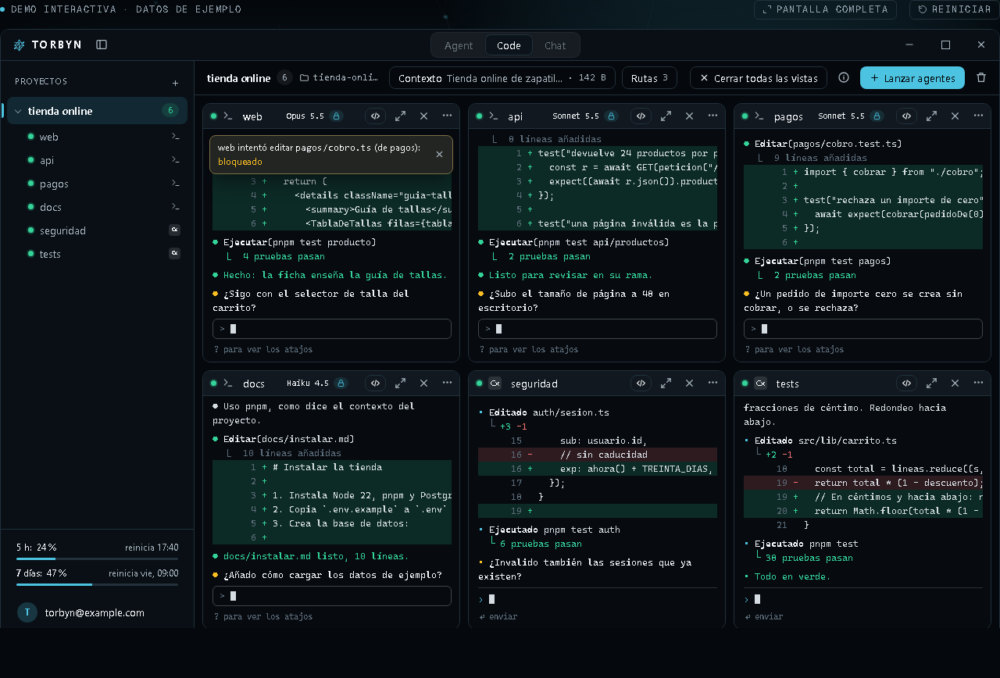
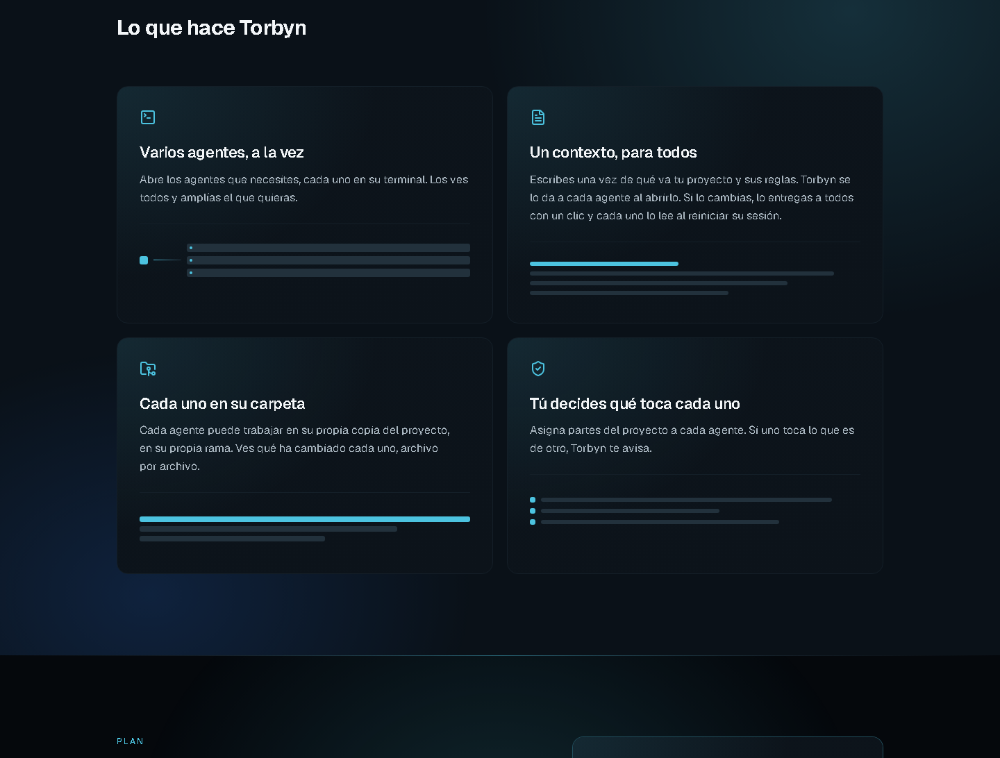
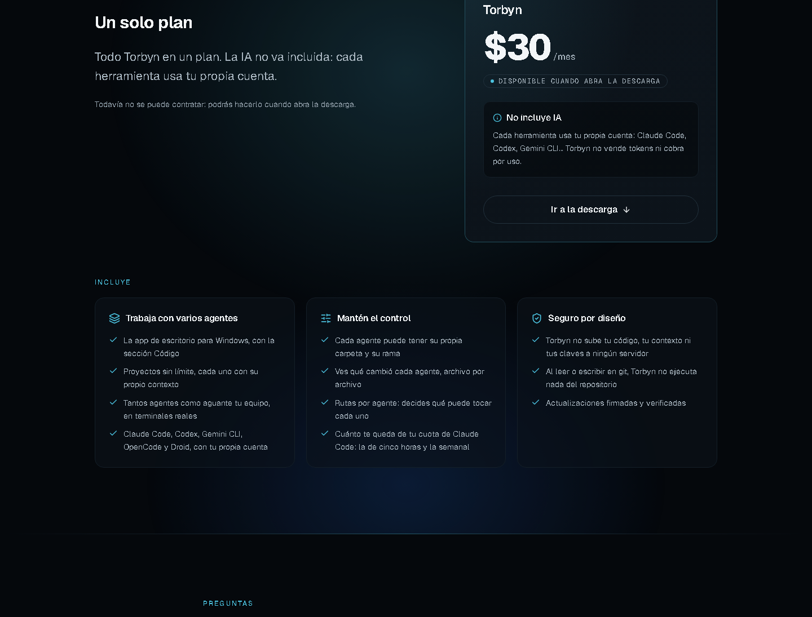
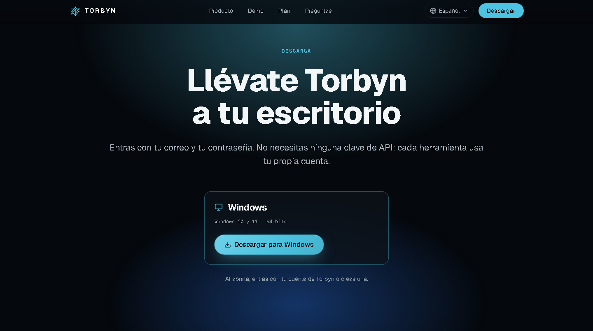

# Torbyn

**Escribe el contexto una vez. Todos tus agentes lo reciben.**

[English version](README.en.md) · [Web](https://torbyn-dashboard.vercel.app) · [Descargar para Windows](https://github.com/diegoai-dev/torbyn-releases/releases/latest/download/Torbyn-Setup.exe)

## Qué es

Torbyn es una app de escritorio para Windows que abre tus agentes de código
—Claude Code, Codex, Gemini CLI, OpenCode y Droid— en terminales reales,
todos en una ventana y con el mismo contexto de proyecto. También puedes
abrir una terminal normal.

Torbyn no incluye IA. Cada herramienta usa tu propia cuenta o suscripción, e
inicia sesión por su cuenta en su terminal.

## Para quién

Para quien trabaja con varios agentes de código a la vez sobre un mismo
proyecto y ya usa esas herramientas con su propia cuenta.

## El problema que resuelve

Con terminales sueltas:

- le explicas el proyecto a cada agente, uno por uno;
- separar sus carpetas es trabajo tuyo;
- vigilar lo que toca cada uno, también.

Y cuando varios agentes trabajan en la misma carpeta, se pisan: dos editan el
mismo archivo y gana el último que escribe.

Con Torbyn:

- escribes el contexto una vez y llega a todos;
- cada agente puede trabajar en su propia copia del proyecto, en su propia
  rama;
- decides qué partes del proyecto puede tocar cada uno;
- ves qué cambió cada agente, archivo por archivo.

## Por qué ahora

Cada vez más personas trabajan con varios agentes de código a la vez sobre el
mismo proyecto. Esos agentes se pisan, y no hay una capa común que les
reparta el mismo contexto y les marque hasta dónde puede llegar cada uno.
Torbyn quiere ser esa capa.

## Cómo funciona

1. **Creas un proyecto.** Puede ser una carpeta nueva o una que ya existe, con
   git o sin él.
2. **Escribes el contexto:** de qué va el proyecto y sus reglas. Lo escribes
   tú; Torbyn no lo resume ni lo cambia.
3. **Lanzas el equipo.** Eliges qué herramientas y cuántos agentes de cada
   una. Cada agente elige dónde trabaja:
   - en la carpeta del proyecto;
   - en un worktree propio, con su rama;
   - en una carpeta nueva;
   - en una carpeta que ya existe.

   Con un repositorio que ya tiene commits, el primer agente usa la carpeta
   del proyecto y los demás un worktree cada uno, para no pisarse.
4. **Torbyn entrega el contexto** en el archivo de reglas que lee cada
   herramienta al arrancar:
   - Claude Code, en su propio archivo;
   - Codex, OpenCode y Droid, en `AGENTS.md`;
   - Gemini CLI, en `GEMINI.md`.

   Si cambias el contexto, lo entregas a todos con un clic, y cada agente lo
   lee al reiniciar su sesión. Con Claude Code se midió que usa el contexto
   entregado; con las demás está entregado, sin medir, y la app lo dice así.
5. **Asignas rutas.** Por ejemplo, `pagos/` solo para el agente de pagos.
   - Con Claude Code, Torbyn impide que un agente edite o cree archivos en una
     ruta de otro. Para eso hace falta Git para Windows.
   - Con las demás herramientas, la ruta les llega como instrucción, y Torbyn
     te avisa si se salen. Para avisarte, cada agente tiene que trabajar en su
     propia carpeta con git.
6. **Revisas los cambios** de cada agente, archivo por archivo. Juntar el
   trabajo de varios agentes lo haces tú, con git.

Además, Torbyn enseña cuánto te queda de tu cuota de Claude Code: la de cinco
horas y la semanal.

### Capturas

Capturas de la web pública. La demo usa sus propios datos de ejemplo, no los
de ninguna persona.

| | |
|---|---|
|  |  |
| La demo de la web, con datos de ejemplo | Qué hace Torbyn |
|  |  |
| El plan | La descarga |

Más capturas, también en inglés, en [`docs/capturas/`](docs/capturas/).

## Privacidad por diseño

- **Tu código, tu contexto y tus claves no salen de tu equipo hacia ningún
  servidor de Torbyn.** La app se conecta a Torbyn solo para tu cuenta
  (entrar, crear la cuenta, ver tus sesiones, salir y borrar la cuenta) y
  para buscar actualizaciones. Cada herramienta habla con su propio servicio,
  según sus condiciones.
- **No lee tus terminales.** Lo que pasa en una terminal va de la herramienta
  a la ventana sin que Torbyn lo lea, lo guarde ni lo envíe. Hay una
  excepción: la posición del cursor (dos números, nunca el texto), para saber
  cuándo quitar el aviso «Abriendo…».
- **No captura nada por su cuenta.** El contexto lo escribes tú.
- **Sin telemetría.** La app no lleva analítica ni informes de fallos, y la
  web no carga ninguna librería de analítica.
- **No guarda tus claves de las herramientas.** Cada una inicia sesión en su
  propia terminal. De Torbyn guarda tu sesión y tu correo, cifrados con la
  protección de Windows, y nunca tu contraseña.
- **Leer tu repositorio no ejecuta nada de él.** Para enseñarte los cambios,
  Torbyn usa git en tu equipo. Lo hace sin ejecutar hooks, filtros ni otros
  programas que el repositorio tenga configurados.
- **Lo que anota se queda en tu equipo, y solo lo justo.** Por ejemplo, la
  cuota de Claude Code o, cuando bloquea una edición, la hora, la herramienta,
  la ruta, su dueño y la decisión.
- **Actualizaciones firmadas.** Torbyn comprueba cada actualización antes de
  instalarla. La rechaza si:
  - el archivo no coincide;
  - la firma no es la suya;
  - viene de otro sitio;
  - es una versión más vieja que la instalada.
- **Puedes borrar tu cuenta** desde Ajustes, con tu contraseña. Se borran tu
  cuenta y sus datos del servidor; tus proyectos no se tocan.
  - Las copias de seguridad de la base de datos pueden conservar esos datos
    durante un tiempo limitado, hasta que se renuevan.
  - Lo que Torbyn guarda en tu equipo (tu sesión, la lista de proyectos y tus
    ajustes) **no se borra al desinstalar**: se quita a mano, borrando la
    carpeta de datos de Torbyn de tu perfil de Windows.

## Estado actual

- **Versión:** 0.1.8, publicada el 6 de noviembre de 2026.
- **Sistema:** solo Windows 10 y 11 de 64 bits.
- **Firma:** el instalador todavía no está firmado con un certificado de
  editor, así que Windows SmartScreen avisa de que el editor es desconocido.
  Junto a la descarga está su SHA-256, para comprobar el archivo.
- **Modos:** está disponible **Code**, el espacio de trabajo con los agentes;
  **Agent** y **Chat** están marcados como «Próximamente».
- **Precio:** un solo plan de 30 $ al mes, sin IA incluida. Todavía no se
  puede contratar.
- **Lo que no hace:**
  - no impide lo que un agente cambia con comandos de terminal (Bash);
  - con las demás herramientas, las rutas son una instrucción, no un bloqueo;
  - no junta el trabajo de los agentes: eso lo haces tú, con git.

## Hoja de ruta

Es una dirección, no un compromiso de fechas.

- **Más herramientas.** En la web figuran como «Próximamente»: Cursor Agent,
  GitHub Copilot, Grok Build, Kimi Code, Amp, Antigravity y Aider.
- **Modo Agent:** varios agentes coordinados entre sí.
- **Modo Chat:** conversar con tu herramienta sin abrir una terminal.
- **Firma de código** del instalador.
- **La capa de confianza:** las garantías alrededor de un equipo de agentes.
  Puntos de restauración, revisión y fusión, verificación y seguir en otra
  herramienta. Hoy existen las rutas asignadas. Resumen en
  [`docs/capa-de-confianza.md`](docs/capa-de-confianza.md).

## Enlaces

- Web: <https://torbyn-dashboard.vercel.app> (en inglés:
  <https://torbyn-dashboard.vercel.app/en>)
- Descarga para Windows: <https://github.com/diegoai-dev/torbyn-releases/releases/latest/download/Torbyn-Setup.exe>
- Versiones publicadas: <https://github.com/diegoai-dev/torbyn-releases/releases>

## Quién está detrás

Torbyn lo hace Diego Gómez, su fundador, desde Panamá
([LinkedIn](https://www.linkedin.com/in/diego-g%C3%B3mez-19b1b9324/)). Es
el fundador y único desarrollador de Torbyn desde agosto de 2026.

Por ahora, el canal de contacto es abrir un *issue* en este repositorio.

## Licencia

Todos los derechos reservados. Ver [LICENSE](LICENSE).

Los nombres y logotipos de las herramientas pertenecen a sus titulares.
Torbyn no está afiliado a ninguno.
