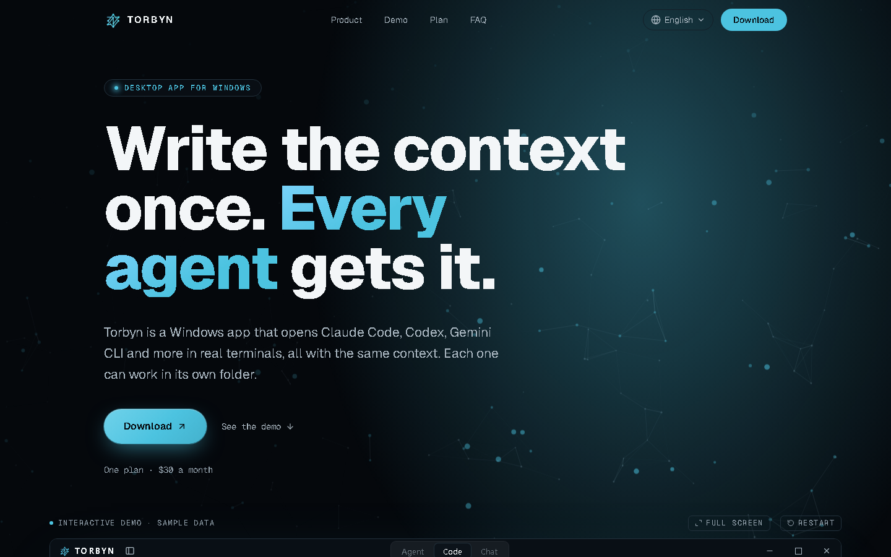
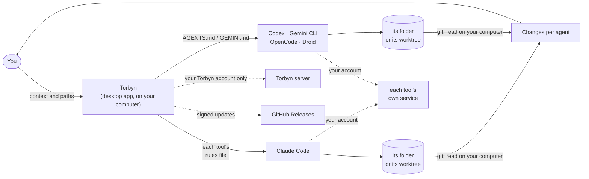
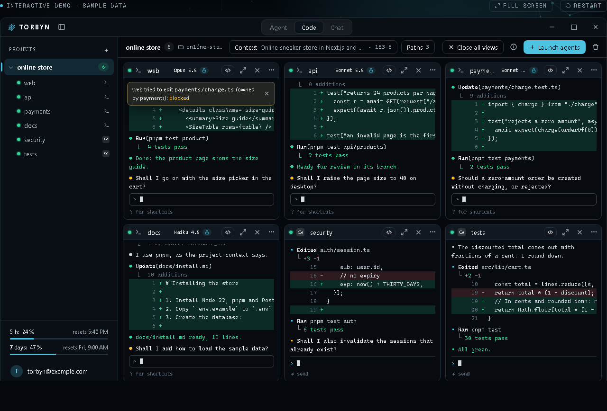
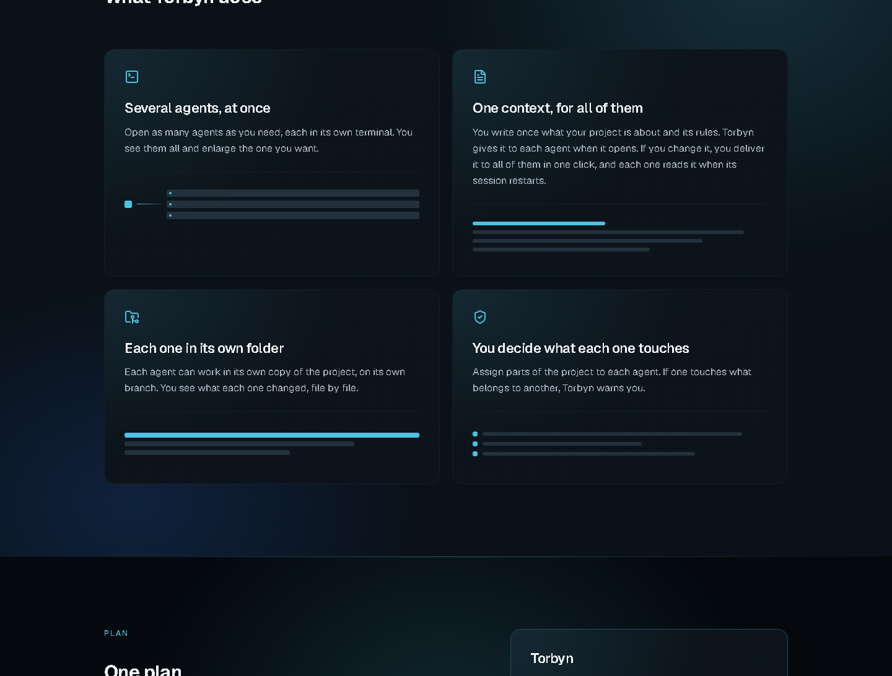
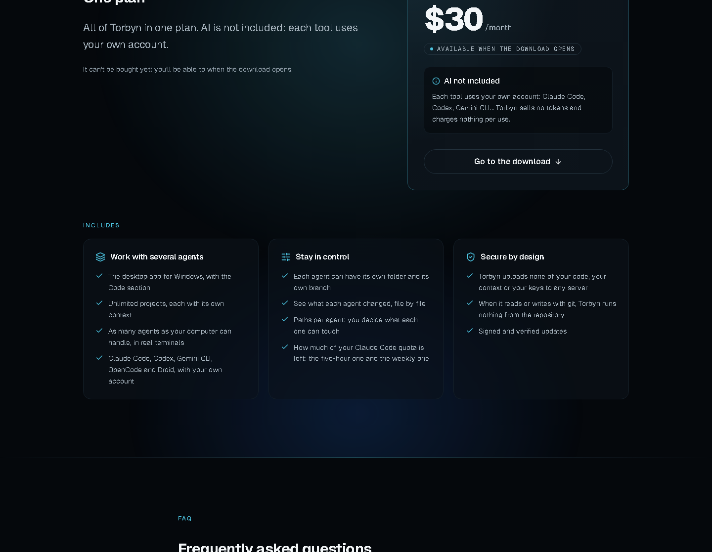
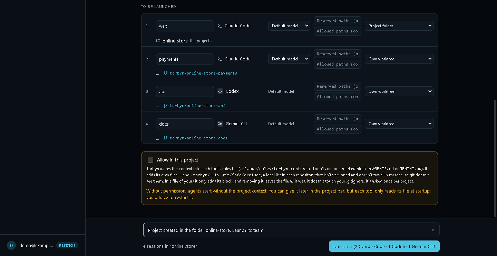
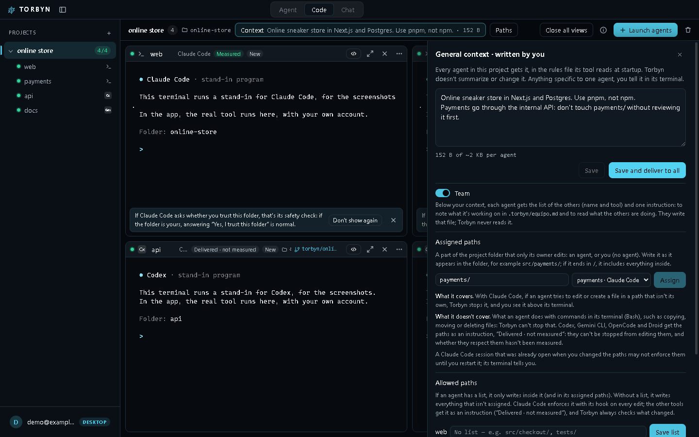

# Torbyn

**The trust layer for your AI workspace.**

*Write the context once. Every agent gets it.*

[Versión en español](README.es.md) · [Website](https://torbyn.com/en) · [Download for Windows](https://github.com/diegoai-dev/torbyn-releases/releases/latest/download/Torbyn-Setup.exe)

## What it is

Torbyn is a Windows desktop app that opens your coding agents —Claude Code,
Codex, Gemini CLI, OpenCode and Droid— in real terminals, all in one window
and with the same project context. You can also open a plain terminal.

Torbyn includes no AI. Each tool uses your own account or subscription and
signs in on its own, in its own terminal.

## Who it is for

People who work with several coding agents at once on the same project and
already use those tools with their own account.

## The problem it solves

With separate terminals:

- you explain the project to each agent, one by one;
- keeping their folders apart is up to you;
- so is watching what each one touches.

And when several agents work in the same folder, they overwrite each other:
two of them edit the same file and the last one to write wins.

With Torbyn:

- you write the context once and it reaches all of them;
- each agent can work in its own copy of the project, on its own branch;
- you decide which parts of the project each one can touch;
- you see what each agent changed, file by file.

## Why now

More and more people work with several coding agents at once on the same
project. Those agents overwrite each other, and there is no common layer that
gives them all the same context and marks how far each one can go. Torbyn
aims to be that layer.

## How it works

1. **You create a project.** It can be a new folder or an existing one, with
   or without git.
2. **You write the context:** what the project is about and its rules. You
   write it; Torbyn doesn't summarise or change it.
3. **You launch the team.** You pick which tools and how many agents of each.
   Each agent chooses where it works:
   - in the project folder;
   - in its own worktree, on its own branch;
   - in a new folder;
   - in an existing folder.

   With a repository that already has commits, the first agent uses the
   project folder and the rest get a worktree each, so they don't overwrite
   each other.
4. **Torbyn delivers the context** in the rules file each tool reads when it
   starts:
   - Claude Code, in its own file;
   - Codex, OpenCode and Droid, in `AGENTS.md`;
   - Gemini CLI, in `GEMINI.md`.

   If you change the context, you deliver it to all of them with one click,
   and each agent reads it when its session restarts. With Claude Code it was
   measured that it uses the delivered context; with the others it is
   delivered but not measured, and the app says so.
5. **You assign paths.** For example, `pagos/` only for the payments agent.
   - With Claude Code, Torbyn stops an agent from editing or creating files
     in another agent's path. This needs Git for Windows.
   - With the other tools, the path reaches them as an instruction, and
     Torbyn warns you if they step out. To warn you, each agent has to work
     in its own folder with git.
6. **You review the changes** of each agent, file by file. Putting several
   agents' work together is up to you, with git.

Torbyn also shows how much of your Claude Code quota you have left: the
five-hour one and the weekly one.

### Screenshots

Screenshots of the public website. The demo uses its own sample data, not
anyone's.

| | |
|---|---|
|  |  |
| The website demo, with sample data | What Torbyn does |
|  |  |
| The plan | The download |

### The app

Screenshots of the desktop app with sample data: a test project (an online
store) made only for these screenshots. The terminals run a stand-in program
instead of the real tools, and say so on screen; in the app, each tool runs
there with your own account.

| | |
|---|---|
|  |  |
| The launcher: each agent with its tool, its model and where it works | A team of four agents, each in its own terminal |
|  |  |
| The project context, and `payments/` being assigned to the "payments" agent | What one agent changed, file by file |

More screenshots, in Spanish too, in [`docs/capturas/`](docs/capturas/).

## Privacy by design

- **Your code, your context and your keys don't leave your computer for any
  Torbyn server.** The app connects to Torbyn only for your account (sign
  in, create the account, see your sessions, sign out and delete the
  account) and to check for updates. Each tool talks to its own service,
  under its own terms.
- **It doesn't read your terminals.** What happens in a terminal goes from
  the tool to the window without Torbyn reading, storing or sending it. There
  is one exception: the cursor position (two numbers, never the text), to
  know when to remove the «Opening…» notice.
- **It captures nothing on its own.** You write the context.
- **No telemetry.** The app carries no analytics or crash reporting, and the
  website loads no analytics library.
- **It doesn't store your tools' keys.** Each one signs in in its own
  terminal. For Torbyn it stores your session and your email, encrypted with
  Windows' protection, and never your password.
- **Reading your repository runs nothing from it.** To show you the changes,
  Torbyn uses git on your computer, without running hooks, filters or other
  programs the repository has configured.
- **What it records stays on your computer, and only what's needed.** For
  example, the Claude Code quota or, when it blocks an edit, the time, the
  tool, the path, its owner and the decision.
- **Signed updates.** Torbyn checks every update before installing it. It
  rejects it if:
  - the file doesn't match;
  - the signature isn't its own;
  - it comes from somewhere else;
  - it's older than the installed version.
- **You can delete your account** from Settings, with your password. Your
  account and its data are deleted from the server; your projects are left
  untouched.
  - Database backups may keep that data for a limited time, until they are
    rotated.
  - What Torbyn stores on your computer (your session, your project list and
    your settings) **is not deleted when you uninstall**: you remove it by
    hand, by deleting Torbyn's data folder from your Windows profile.

## Current status

- **Version:** 0.1.8, released on 6 November 2026.
- **System:** 64-bit Windows 10 and 11 only.
- **Signing:** the installer isn't signed with a publisher certificate yet,
  so Windows SmartScreen warns that the publisher is unknown. Its SHA-256 is
  next to the download, so you can check the file.
- **Modes:** **Code**, the workspace with the agents, is available; **Agent**
  and **Chat** are marked «Coming soon».
- **Price:** a single plan at $30 a month, with no AI included. It can't be
  bought yet.
- **What it doesn't do:**
  - it doesn't stop what an agent changes with terminal commands (Bash);
  - with the other tools, paths are an instruction, not a block;
  - it doesn't put the agents' work together: you do that, with git.

## Roadmap

A direction, not a commitment to dates.

- **More tools.** Listed on the website as «Coming soon»: Cursor Agent,
  GitHub Copilot, Grok Build, Kimi Code, Amp, Antigravity and Aider.
- **Agent mode:** several agents coordinated with each other.
- **Chat mode:** talk to your tool without opening a terminal.
- **Code signing** for the installer.
- **The trust layer:** guarantees around a team of agents. Restore points,
  review and merge, verification and continuing in another tool. Today,
  assigned paths exist. Summary (in Spanish) in
  [`docs/capa-de-confianza.md`](docs/capa-de-confianza.md).

## Links

- Website: <https://torbyn.com/en>
- Download for Windows: <https://github.com/diegoai-dev/torbyn-releases/releases/latest/download/Torbyn-Setup.exe>
- Published versions: <https://github.com/diegoai-dev/torbyn-releases/releases>

## Who's behind it

Torbyn is made by Diego Gómez, its founder, from Panama
([LinkedIn](https://www.linkedin.com/in/diego-g%C3%B3mez-19b1b9324/)). Founder
and sole developer of Torbyn since August 2026.

For now, the contact channel is opening an *issue* in this repository.

## License

All rights reserved. See [LICENSE](LICENSE).

Tool names and logos belong to their owners. Torbyn is not affiliated with
any of them.
